# Диаграмма классов NDT Lab

Сплошные стрелки с ромбом — владение, простые стрелки — ссылка (`&`) или поле-перечисление,
пунктир — использование. Пунктир от `Report` к справочникам — ссылка по id или шифру: заключение
хранит идентификаторы выбранных записей, а не сами записи. Перечисления хранятся в базе строкой
(`GetXStr` / `ParseX`), их значения здесь не перечислены.

```mermaid
classDiagram
    direction TB

    %% ---------- приложение ----------
    class Core {
        -ApplicationData appData
        -unique_ptr~ResourceManager~ resManager
        -unique_ptr~Laboratory~ lab
        -unique_ptr~Gui~ imWindow
        +Init() SDL_AppResult
        +Iterate() SDL_AppResult
        +ProcessEvent(event) SDL_AppResult
    }
    class Gui {
        -ApplicationData& appData
        -ResourceManager& resManager
        -Laboratory& lab
        +IterateImGui()
        +RenderImGui()
        +ApplyScale()
        +RequestQuit()
        +ShouldQuit() bool
        -ButtonsWindow()
    }
    class ApplicationData
    class ResourceManager {
        +LoadDevices(path) vector~XrayDevice~
    }
    class XrayDevice {
        +string name
        +vector~Curve~ curveVector
        +float voltageMaximum
        +float focusDistanceDefault
    }
    class Curve {
        +string label
        +vector~float~ xData
        +vector~float~ yData
        +float voltage
    }

    %% ---------- окна ----------
    class SettingsWindow
    class LabWindow {
        -Laboratory& lab
        +Show(isOpen)
        +ShowMain()
    }
    class NomogramWindow {
        -vector~XrayDevice~ devices
        +Show()
    }
    class ReportWindow {
        +Show(vector~Report~, Laboratory)
        +Edit(Report, isOpen, Laboratory)
    }
    class DefectCreateWindow {
        +Show(Report, isOpen, isUnsaved)
    }
    class EmployeesWindow
    class InspectorsWindow
    class MastersWindow
    class WeldersWindow
    class EquipmentWindow
    class ControlMapsWindow
    class NormativeDocumentsWindow
    class ReportBuilder {
        +BuildReportRGC(reports, indexes)
    }
    class PdfManager

    %% ---------- модель ----------
    namespace NDT {
        class DbRecord {
            +string id
            +sys_seconds updatedAt
            +optional~sys_seconds~ deletedAt
        }
        class AttachedFile {
            +string id
            +string name
            +vector~uint8_t~ data
            +IsEmpty() bool
            +LoadFromDisk(path) bool
            +Open()
        }
    }

    class Laboratory {
        -bool isLoaded
        +LoadDB()
        +SaveDB()
        +IsLoaded() bool
        +IsUnsaved(DbRecord) bool
        +HasUnsavedChanges() bool
    }
    class DatabaseManager {
        -sqlite3* db
        -sys_seconds syncedAt
        +SaveXxx(vector~Xxx~)
        +LoadXxx() vector~Xxx~
        +SaveReports(vector~Report~)
        +LoadReports() vector~Report~
        +IsChanged(DbRecord) bool
        -SaveFilmMeasurements(reportId, vector)
        -SaveDefectsRt(reportId, vector)
        -SaveAttachedFile(AttachedFile)
        -EnsureXxxTable()
        -DeleteOrphanFiles()
    }

    class LaboratoryInfo {
        +string laboratoryName
        +string numberAttestation
        +string attestationEndDate
    }
    class Employee {
        +string name
        +string personalCode
        +string level
        +string certificateNumber
        +bool hasVT … hasLT
        +string certificateEndDateVT … LT
    }
    class Inspector {
        +string name
        +string certificateNumber
        +bool hasVT … hasLT
        +string certificateEndDateVT … LT
    }
    class Master {
        +string name
        +string certificateNumber
        +string certificateEndDate
    }
    class Welder {
        +string name
        +string personalCode
        +string certificateNumber
        +string certificateEndDate
    }
    class ControlMap {
        +string code
        +int diameter
        +float nominalWallThickness
        +bool forVT … forDT
        +bool categoryB … categoryIV
    }
    class NormativeDocument {
        +string code
        +string name
        +string status
        +bool forVT … forECT
    }
    class Equipment {
        +string name
        +string serialNumber
        +string certificateEndDate
        +bool forVT … forECT
        +bool isOperational
    }

    class Report {
        +string reportNumber
        +string controlDate
        +int diameter
        +float thicknes1
        +float thicknes2
        +int ellipseExposureCount
        +vector~string~ normativeDocsIds
        +vector~string~ equipmentIds
        +vector~string~ weldersIds
        +string technologicalControlMap
        +vector~string~ sectionNotes
        +GetMinSeamDistance() optional~int~
        +GetSectionCount() int
        +GetSectionRangeStr(section) string
        +GetMeasurementCount() int
        +SetDefaultMeasurementCoords()
        +GetSectionDefectsStr(section) string
        +IsSectionAcceptable(section) bool
        +GetDefectRecord(DefectRt, count) string
    }
    class DefectRt {
        +string reportId
        +float length
        +float width
        +float height
        +bool endGreaterThan
        +int coord
        +int exposure
        +bool acceptable
    }
    class FilmMeasurement {
        +string reportId
        +int coord
        +float sensitivity
        +float weldDensity
        +float hazDensity
        +float densityDiff
    }

    %% ---------- перечисления ----------
    class Method
    <<enumeration>> Method
    class Category
    <<enumeration>> Category
    class WeldJointType
    <<enumeration>> WeldJointType
    class WeldingMethod
    <<enumeration>> WeldingMethod
    class SectionType
    <<enumeration>> SectionType
    class ExposureScheme
    <<enumeration>> ExposureScheme
    class ControlResult
    <<enumeration>> ControlResult
    class Roughness
    <<enumeration>> Roughness
    class DefectRtSymbol
    <<enumeration>> DefectRtSymbol

    %% ---------- связи: приложение и окна ----------
    Core *-- ApplicationData
    Core *-- ResourceManager
    Core *-- Laboratory
    Core *-- Gui

    Gui --> ApplicationData
    Gui --> ResourceManager
    Gui --> Laboratory
    Gui *-- SettingsWindow
    Gui *-- LabWindow

    LabWindow --> Laboratory
    LabWindow *-- NomogramWindow
    LabWindow *-- ReportWindow
    LabWindow *-- EmployeesWindow
    LabWindow *-- InspectorsWindow
    LabWindow *-- MastersWindow
    LabWindow *-- WeldersWindow
    LabWindow *-- EquipmentWindow
    LabWindow *-- ControlMapsWindow
    LabWindow *-- NormativeDocumentsWindow

    ReportWindow *-- DefectCreateWindow
    ReportWindow *-- ReportBuilder : builder
    ReportBuilder ..> PdfManager : создаёт
    ReportBuilder ..> Report : печатает

    NomogramWindow ..> ResourceManager : LoadDevices
    NomogramWindow *-- "0..*" XrayDevice : devices
    XrayDevice *-- "0..*" Curve

    %% ---------- связи: модель ----------
    DbRecord <|-- LaboratoryInfo
    DbRecord <|-- Employee
    DbRecord <|-- Inspector
    DbRecord <|-- Master
    DbRecord <|-- Welder
    DbRecord <|-- ControlMap
    DbRecord <|-- NormativeDocument
    DbRecord <|-- Equipment
    DbRecord <|-- Report
    DbRecord <|-- DefectRt
    DbRecord <|-- FilmMeasurement

    Laboratory *-- "1" DatabaseManager : dbManager
    Laboratory *-- "1" LaboratoryInfo : labInfo
    Laboratory *-- "0..*" Employee : employeesList
    Laboratory *-- "0..*" Inspector : inspectorsList
    Laboratory *-- "0..*" Master : mastersList
    Laboratory *-- "0..*" Welder : weldersList
    Laboratory *-- "0..*" ControlMap : controlMapsList
    Laboratory *-- "0..*" NormativeDocument : normativeDocumentsList
    Laboratory *-- "0..*" Equipment : equpmentsList
    Laboratory *-- "0..*" Report : reportsList

    Report *-- "0..*" DefectRt : defRGCList
    Report *-- "2..4" FilmMeasurement : filmMeasurements

    ControlMap *-- "0..1" AttachedFile : file
    NormativeDocument *-- "0..1" AttachedFile : file
    Equipment *-- "0..1" AttachedFile : file

    Report ..> "0..*" NormativeDocument : normativeDocsIds
    Report ..> "0..*" Equipment : equipmentIds
    Report ..> "0..*" Welder : weldersIds
    Report ..> "0..1" ControlMap : code

    DatabaseManager ..> DbRecord : IsChanged

    Report --> Method : methodValue
    Report --> Category : pipeCategory
    Report --> WeldJointType : weldType
    Report --> "1..*" WeldingMethod : weldingMethods
    Report --> "2" SectionType : sectionType1/2
    Report --> ExposureScheme : exposureScheme
    Report --> ControlResult : controlResult
    Report --> Roughness : roughness
    DefectRt --> DefectRtSymbol : symbol
```

